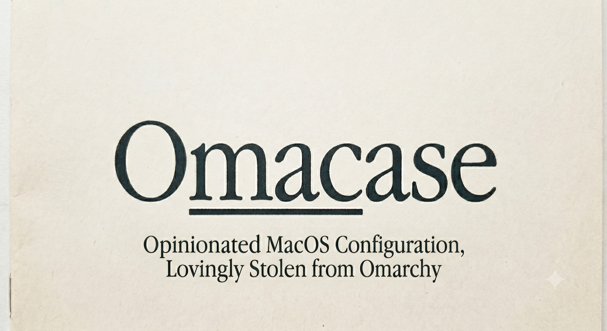

# Omacase

**Omarchy for macOS, with macOS allowed to remain macOS.**

Omacase is light configuration management, a coherent theming system, and an
opinionated application installer/updater for Apple Silicon Macs. Window
management stays with macOS.

Supported platform: Apple Silicon, macOS 26 or later, and Homebrew at
`/opt/homebrew`.

```bash
/bin/bash -c "$(curl --proto '=https' --tlsv1.2 -fsSL https://omacase.org/install)"
omacase doctor
```

## What it manages

| Layer | Choice |
|---|---|
| Launcher | **Sol** on ⌘Space (replaces Spotlight's shortcut) |
| Terminal | **Ghostty**, zsh, Starship, herdr, and a modern CLI set |
| Editor | **Neovim / LazyVim** |
| Applications | **Homebrew + Brewfile** |
| Dotfiles | Omacase-owned symlinks from `home/` |
| Themes | 23 coordinated themes for terminal, CLI, editor, prompt, macOS appearance/accent, and wallpaper |
| Recovery | Snapshots of managed config and touched macOS defaults |

## Daily commands

```text
omacase install             idempotent full setup
omacase update              update Omacase, packages, apps, and managed config
omacase doctor              check tooling, macOS settings, and permissions
omacase keybinds            display the complete key reference
omacase theme [name]        apply a coordinated theme
omacase palette [name]      edit a theme's terminal ANSI palette
omacase wallpaper [...]     list or change the active theme wallpaper
omacase webapp [name]       open a named web app
omacase backup [label]      snapshot managed config and macOS defaults
omacase restore [id]        restore a snapshot
omacase migrate             run one-time changeovers
omacase usage [update]      agent usage dashboard — token burn + plan limits (Claude, Codex, Grok)
omacase tools               list every tool Omacase installs, one line each
omacase extras [name]       optional opt-in tweaks: sudo-touchid, mole, usage-tracker (never run by install)
omacase uninstall           remove Omacase-managed config; keep applications
```

Set `OMACASE_DRYRUN=1` before `omacase install` to preview changes. Set
`OMACASE_INSTALL_GROK=1` to explicitly
allow xAI's unpinned Grok installer; it is skipped by default. Set
`OMACASE_CHANNEL=dev` to make `omacase update` pull the default branch
(maintainer machines); the default `stable` channel checks out the latest
`v*` release tag. `omacase update --check` lists pending changes without
applying them; `omacase update --rollback` returns to the previous payload.

Omacase never needs admin rights itself; Homebrew does for some casks (pkg
installers, launch daemons, root-owned app bundles). When a run will touch one
of those, `omacase install`/`update` authenticate **once** up front and keep
that authorization alive for the rest of the run; formulae-only runs never ask.
`omacase extras sudo-touchid` makes that one prompt a Touch ID and shares it
across terminals for an hour.

## Agent multiplexing

`herdr` is the agent-aware multiplexer. `omacase install` wires up the **state
hooks** for every agent CLI it ships — each agent reports
`idle`/`working`/`blocked`/`done` back to herdr, which drives its agent sidebar
and `herdr agent` commands (managed by
`herdr integration status|install|uninstall <agent>`). The reverse direction —
the *skill* that lets agents drive herdr's panes, tabs, and workspaces — is
installed and kept fresh by herdr itself on launch, so Omacase stays out of
`~/.agents/skills`.

The hook step is idempotent and re-runs on `omacase update`, so a harness
installed later is picked up on the next run. Because herdr's server outlives its client,
`herdr --remote <host>` leaves an agent running on a remote machine after the
laptop disconnects.

## Shortcuts

Sol takes `⌘ Space`; window management is stock macOS. See
[KEYBINDS.md](KEYBINDS.md) or run `omacase keybinds`.

## Themes and ownership

`omacase theme <name>` rethemes Ghostty, btop, Neovim, Starship, Claude Code,
the macOS Light/Dark appearance and accent, and the wallpaper. It also writes a
neutral palette link at `~/.config/omacase/theme.sh` for future integrations.

Omarchy-derived colors and wallpapers are downloaded from Basecamp's Omarchy
repository and cached under `~/.local/share/omacase`. Local themes live in
`themes/`; see [docs/ADDING_A_THEME.md](docs/ADDING_A_THEME.md).

## Boundaries

Omacase does not automate macOS privacy grants. Sol needs Accessibility.
Theme appearance sync needs Automation access from your terminal to System
Events.

Omacase also leaves native screenshots, Focus modes, media controls, clipboard
history, and app switching to macOS.

## License

Omacase's original code and assets are MIT licensed. Third-party applications
and downloaded artifacts retain their upstream licenses. See
[THIRD_PARTY_NOTICES.md](THIRD_PARTY_NOTICES.md).
